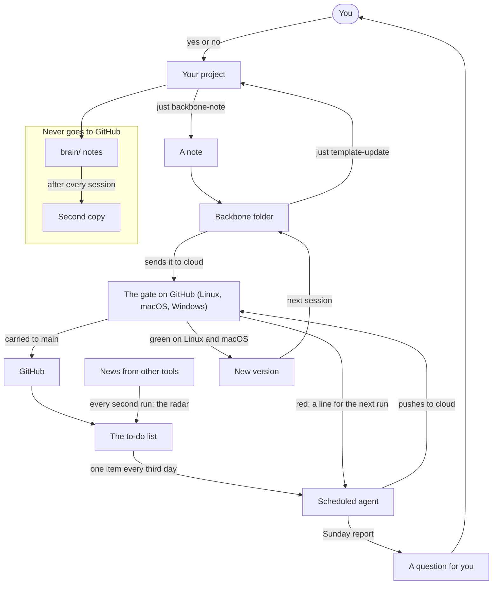
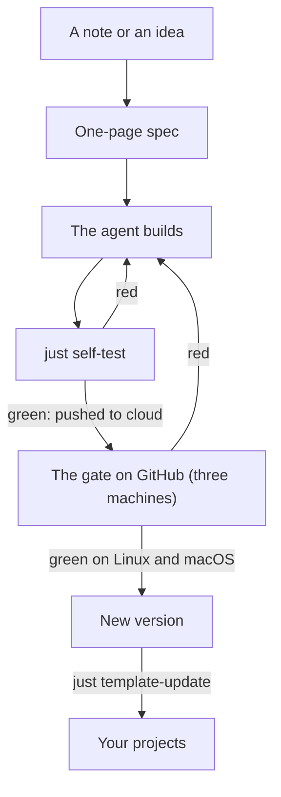

# How it works

Two pictures, for a person who does not read code. GitHub draws them by itself
from the text in this file, so there is no image to keep current: when the
backbone changes, the words below change and the picture follows.

## The loop

Start at **Your project**. An agent working there notices something about the
backbone (a fault, a gap, an idea) and leaves a note with
`just backbone-note`. The note goes through the backbone folder that sits next
to your projects to the branch `cloud` on GitHub, where the gate carries it to
`main` and it joins the to-do list (`docs/backlog.md`, which anyone can read:
the line carries an id and never a project's name: the backbone knows no project, and a lesson that
comes from one keeps the lesson and drops the project: no quote from its documents, no decision or
spec number, no commit hash, no test name or log line from its CI, no list of its plans or defects,
no set of its pins). A scheduled agent takes one item from that list every
third day, builds it, tests it and pushes it to the branch `cloud`. A gate on GitHub
tests that push again on a clean Linux, a clean Mac and a clean Windows
machine. Since 2026-11-12 the gate carries a push when Linux and macOS are
green, code included (spec 017). Windows still runs, and a red run writes one
line on cloud; it does not hold `main` back. A release still waits for a green
Windows run. Green docs (a note, a
log line, a spec) go to `main` on their own, without waiting for Windows.
`just carry` still moves a green commit now. The carried commit becomes a
new version, tagged. `STABLE` is still marked by a session you are in.
Red leaves one line that the next run reads first and fixes. Before the list, each run checks
the tools the backbone is built on: when one has a new release, the run moves
to it, and the gate tests it on Linux, macOS and Windows before it reaches
`main`.
Every second run the agent looks outward instead: the radar reads what the
standards and agent tools around the backbone have published and adds what
matters to the same list, as ideas. The next time an agent opens any
of your projects, the backbone folder takes the new version from GitHub. The
agent in that project sees "behind" and takes the version in with
`just template-update`. You never open the backbone folder; it only has to
stay where it is.

Two smaller loops run beside the big one. What only you can decide waits on
the list as a line that begins `- [?]`, never more than three of them. Sunday's
report asks you the oldest one as a question that yes or no answers, you tell
the answer to the agent in any project, and it travels back as a note that
begins `decision:`. And `brain/`, your private notebook, never goes to GitHub.
It stays on your computer. A second copy is written into the place you named
once for this machine, at the start of a session, at most once an hour while
a session is open, after a delegate job is accepted, every few hours from the
desk, and at the end of a session. The desk runs `just vault-sweep` for every
sibling project, or `just vault-sweep-install` so Claude Code runs that sweep
at most once every 3 hours. That is not a scheduled job: a scheduled job cannot
read the Desktop. A project that turned that
copy off stays off. When a copy is older than 24 hours, `just doctor` and the
session name the project and the age. Secrets live in `brain/secrets/`,
inside that copy, until `just secrets-to-keystore` moves a token file into the
operating system's keystore. `just with-secret` reads one account onto a
command's standard input at the moment of use. A night step that needs a secret is skipped and named in the morning.
CI does not call the reader; the key stays in the platform's own store.

## The life of one idea

Every change to the backbone goes the same way, whoever starts it. A note from
a project, or an idea the radar brought in, becomes a one-page spec in
`docs/specs/` when it is bigger than a small fix. The agent builds it, and
`just self-test` tries it out on throwaway projects. Red means it is not saved,
and the agent goes back to building. Green is pushed to the branch `cloud`,
where GitHub runs the same suite on a clean Linux, Mac and Windows machine.
When Linux and macOS are green, it becomes a new version on `main` (Windows
runs too and reports on cloud, but does not hold `main` back),
tagged, with an entry in `CHANGELOG.md` (spec 017); each of your projects
takes it in the next time an agent works there. Whatever would change
something you type waits for your yes first, as a question in the loop above.

## What the permission list is, and is not

`.claude/settings.json` lists the commands Claude Code may run without asking
(`just`, `git commit`, ...) and some it must never run (`git push --force`,
`rm -rf` and its other spellings, `sudo`). It guards habits: it stops the
command the way an agent usually writes it. It is not a security boundary.
Claude Code matches the text of the command, so `/bin/rm -rf` or
`bash -c 'rm -rf x'` is not the same text and is not stopped by it (Claude
Code's own permissions page says so, read 2026-10-18). Other agents (Codex,
Gemini CLI, Cursor, Zed's own agent) do not read this file at all. What really
holds is elsewhere: the gate, which nothing on `cloud` can change, your yes
before code reaches `main`, and `brain/` never leaving your machine.

The file is a seed. A new project gets a copy, and after that the file is the
project's. `just template-update` does not replace it. When `WORKER` is
`grok`, `claude`, `opencode` or `kimi`, a new project and `just template-update` add
four allow rules, so Claude Code may run `just delegate`, `just delegate-status`,
`just delegate-accept` and `just delegate-drop` without asking. A rule the
project wrote stays. With `WORKER` unset or `off`, nothing is added. The same
merge runs on `just hooks-install` and on `just adopt`.
